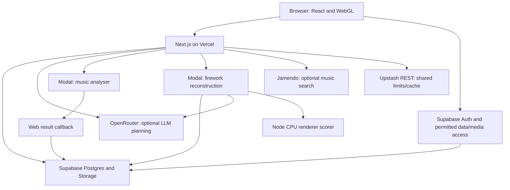

# Technical overview for the receiving developer

## System boundaries

The app is a pnpm workspace with Next.js 16, React 19, TypeScript and Tailwind.
Node 24 and pnpm 12.3.4 are pinned. Supabase owns persistent data, authentication,
row-level security and object storage. Python 3.11 services deploy separately to
Modal. A web deployment neither deploys those services nor transfers accounts.

## Repository map

| Directory                                          | Responsibility                                                        |
| -------------------------------------------------- | --------------------------------------------------------------------- |
| `apps/web/app/`                                    | Page routes, layouts, API handlers and route-owned actions/components |
| `apps/web/lib/`                                    | Domain rules, server integrations, validation and data access         |
| `apps/web/ui/`                                     | Shared controls, workspace shells and feature components              |
| `packages/renderer/`                               | Renderer schema, simulation and preview support                       |
| `packages/video-fit/`                              | Node bridge/scoring for video reconstruction                          |
| `packages/fireworks/`, `packages/firework-editor/` | Retained fireworks/editor contracts and behaviour                     |
| `services/music-analyser/`                         | Audio processing, beat tracking and queued result delivery            |
| `services/firework-import-worker/`                 | Video measurement, interpretation and fitting                         |
| `supabase/migrations/`                             | Ordered database schema and subsequent changes                        |
| `supabase/bootstrap/`                              | Curated reusable data/media snapshot and manifest                     |
| `supabase/tests/`                                  | SQL contracts for permissions, jobs and domain behaviour              |
| `scripts/database/`                                | Guarded local setup, bootstrap, verification and admin provisioning   |
| `.github/workflows/`                               | CI, production migration/deployment and analyser regression           |
| `docs/`                                            | Maintained technical references and this handover pack                |

Use the tracked tree and current entry points when investigating a checkout.
Untracked folders are not evidence of another deployed service. Follow
[Architecture](../architecture.md) before reorganising code.

## Main data flows

### Identity and authorisation

Supabase Auth establishes identity. Web session adapters and `lib/auth` handle
sessions and authentication redirects. `lib/access` resolves profile state and
effective permissions. Server actions, API handlers and database RLS enforce the
actual boundary. Hiding a navigation link alone does not authorise an operation.
A service-role key bypasses ordinary RLS and belongs only in trusted server tools.

### Show creation and music

The guided brief becomes a persisted show only at final generation. Catalogue
selection, constraints and cue planning live in the owning `lib` domains, including
`shows` and `cue-generation`. Music analysis receives signed Storage URLs.
Queued dispatch acknowledges quickly, runs analysis in Modal and posts validated
results to the guarded callback. Attempt/lease checks prevent stale completion
from replacing a newer attempt or settling the credit reservation twice.

The analyser uses the pinned Beat This! checkpoint and verifies its checksum at
image build time. CPU inference uses two Torch threads. Cold starts and model
availability must be checked on the receiving Modal deployment.

### Rendering and imports

Renderer templates and catalogue mappings determine browser appearance. Video
reconstruction measures footage, interprets template candidates and fits them
using `packages/video-fit` and the renderer's CPU simulation. It does not run
Playwright Chromium. The web app dispatches durable import runs to Modal; a local
polling worker is available for development. Atomic claims/leases prevent two
executors completing the same run.

The renderer/import contract spans web code, the worker and database validation.
Source paths and bytes contribute to its fingerprint. If the contract changes,
release those boundaries together and revalidate sealed evidence before publishing.
See [Development](../development.md) for the applicable contract checks.

### Assortments, shopping and exports

Assortments constrain a public QR show to the selected catalogue products and
quantities. Public tokens are capabilities and should not be logged indiscriminately.
Shopping lists derive from show cues. Finale IDs come from explicit catalogue
mapping fields; missing mappings stay visible rather than being guessed.

## Database and content lifecycles

Schema migrations, reusable catalogue snapshots and operational backups solve
different problems. The bootstrap snapshot is for an empty installation. It
contains reusable catalogue content, media, roles, prompts and settings but omits
old users, user shows, balances, jobs and logs. It is not a backup of production.

`db:bootstrap` validates the manifest, refuses populated application tables and
uses an installation receipt to avoid overwriting catalogue edits. Local fixtures
add synthetic users, credits and sample shows only to the exact local endpoint.
`db:verify` compares a fresh installation to the snapshot before accounts/fixtures
exist. It is not a routine production drift check after the client begins editing.

Keep released migrations immutable. Add subsequent migrations, test a clean local
installation and SQL contracts, regenerate types and deliver compatible web/service
changes. The fresh baseline is not an in-place upgrade procedure for an old project.
The [database guide](../database.md) owns the exact procedures and content selection.

## Automated checks

| Command                     | Evidence provided                                                                 |
| --------------------------- | --------------------------------------------------------------------------------- |
| `pnpm check`                | Formatting, schema/catalogue generation, database tooling, package and web checks |
| `pnpm test:analyser`        | Python music analyser behaviour                                                   |
| `pnpm test:worker`          | Python reconstruction worker behaviour                                            |
| `pnpm test:import-contract` | Worker output accepted by app/renderer contracts                                  |
| `pnpm db:test`              | Local transactional SQL contract suites                                           |
| `pnpm db:types --check`     | Generated types agree with installed local schema                                 |
| `pnpm knip`                 | Unused files, exports and dependency checks                                       |

The service suites need their virtual environments; database suites need Docker
and the installed local stack. CI additionally exercises a clean database and the
Python-to-Zod-to-planner contract. Automated checks do not establish live email,
provider authentication, client hardware performance or external Finale acceptance.
